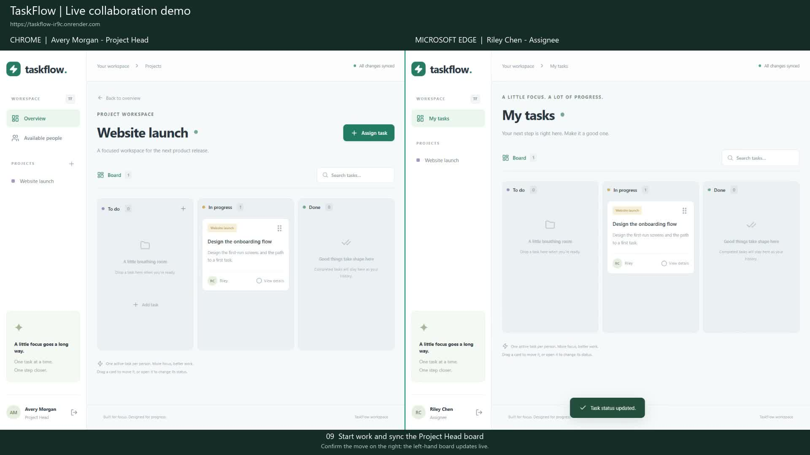
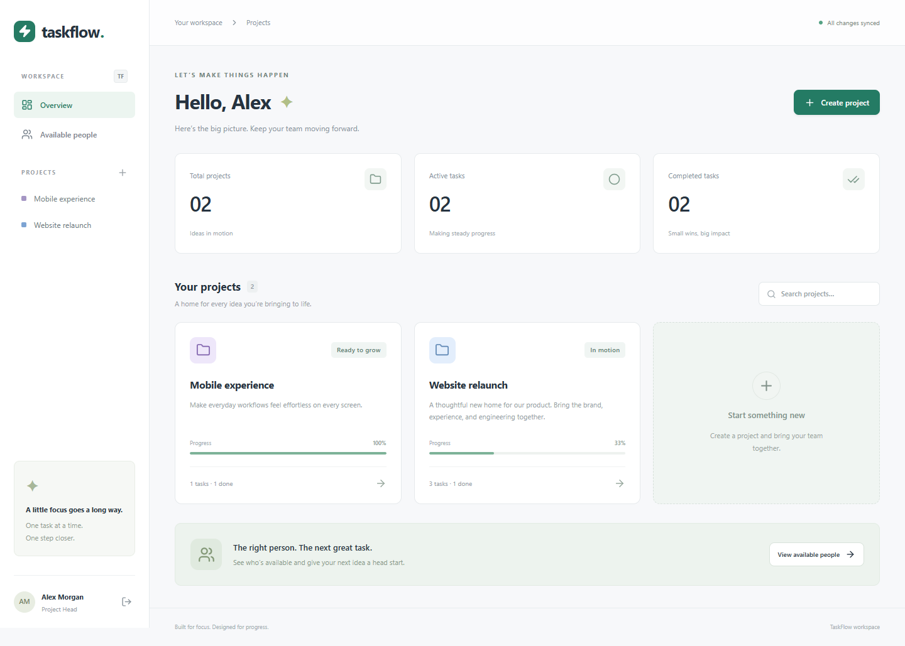
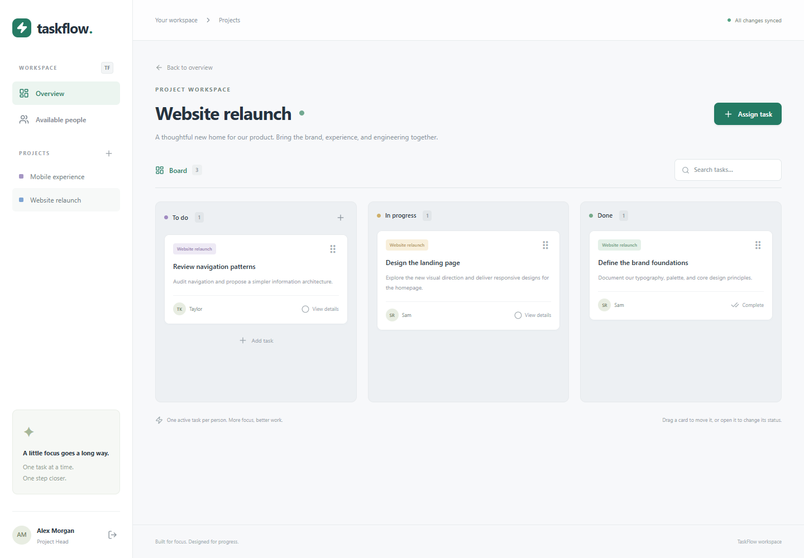

# TaskFlow

TaskFlow is a full-stack task manager with separate dashboards for Project Heads and Assignees. Project Heads create projects and assign tasks. Assignees update their work on a Kanban board, with changes reflected in both accounts in real time.

Each Assignee can have only one active task across all projects. This is enforced by a PostgreSQL partial unique index.

[Live app](https://taskflow-ir9c.onrender.com/) · [Eraser workspace](https://app.eraser.io/workspace/gknUKkNzJfMigKx05xz5)

## Demo

The recording shows a Project Head in Chrome and an Assignee in Edge, side by side. It covers registration, project creation, assignment, edits, drag-and-drop, completion, and the one-active-task rule.

[](https://github.com/V-Rytham/TaskFlow/raw/refs/heads/main/videos/taskflow-demo.mp4)

[Download the recording](https://github.com/V-Rytham/TaskFlow/raw/refs/heads/main/videos/taskflow-demo.mp4) — 2:55, 1080p, with on-screen captions. [Subtitle file](videos/taskflow-demo.srt).

## Stack

- **Frontend:** React, TypeScript, Vite, Tailwind CSS, React Router, TanStack Query, dnd-kit
- **Backend:** Express, TypeScript, PostgreSQL, Prisma, Socket.IO, Zod
- **Authentication:** JWT sessions in HttpOnly cookies and Argon2id password hashing
- **Tests:** Vitest, React Testing Library, Playwright

## Prerequisites

- Node.js **22.19 or later within the 22.x release** and npm
- Docker Desktop with Compose, or an existing PostgreSQL 16+ instance

## Installation

```sh
git clone https://github.com/V-Rytham/TaskFlow.git
cd TaskFlow
npm install
```

Run the remaining commands from the project root.

## Environment variables

Copy `.env.example` to `server/.env` if that file does not already exist. Keep the actual `.env` file out of Git.

| Variable        | Purpose / local value                                                           |
| --------------- | ------------------------------------------------------------------------------- |
| `DATABASE_URL`  | PostgreSQL connection string; the example matches Docker Compose on port `5434` |
| `JWT_SECRET`    | A random secret of at least 32 characters; replace the example placeholder      |
| `CLIENT_ORIGIN` | `http://127.0.0.1:5173`                                                         |
| `PORT`          | `4000`                                                                          |
| `NODE_ENV`      | `development`                                                                   |

Generate a value for `JWT_SECRET` with:

```sh
node -e "console.log(require('node:crypto').randomBytes(48).toString('hex'))"
```

Paste the output into `server/.env`.

## Database setup

Start Docker Desktop, then start PostgreSQL:

```sh
npm run db:start
```

If PostgreSQL is already installed, create a database, set its connection string in `DATABASE_URL`, and skip `db:start`.

Generate Prisma Client, apply the migrations, and load the local demo data:

```sh
npm run db:generate
npm run db:migrate
npm run db:seed
```

The seed creates two Project Heads, three Assignees, and tasks in all three statuses. Skip seeding if you want an empty database.

## Run the app

```sh
npm run dev
```

- Frontend: **http://127.0.0.1:5173**
- API health check: **http://127.0.0.1:4000/api/health**

Keep the development servers running. After a restart, start the database before running `npm run dev` again.

## Local demo accounts

All seeded accounts use **`TaskflowDemo!2026`**. These accounts are for local testing only; they are not created automatically on the live app.

| Role         | Email                 |
| ------------ | --------------------- |
| Project Head | alex@taskflow.local   |
| Project Head | jordan@taskflow.local |
| Assignee     | sam@taskflow.local    |
| Assignee     | taylor@taskflow.local |
| Assignee     | casey@taskflow.local  |

## Checks

```sh
npm run lint
npm run typecheck
npm run build
npm run test
npm run test:e2e
```

Tests cover authentication, ownership, task visibility, concurrent assignments, status changes, and real-time updates. Run the build before the tests because the production tests check the built frontend. Integration tests need the local database; browser tests also need the development servers running and Microsoft Edge installed.

## Screenshots

<details>
<summary>Project Head dashboard and project board</summary>

**Project Head dashboard**



**Project Kanban board**



</details>
